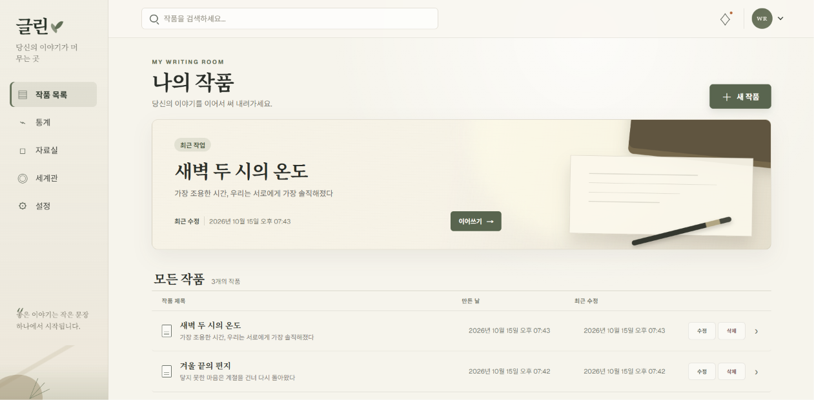
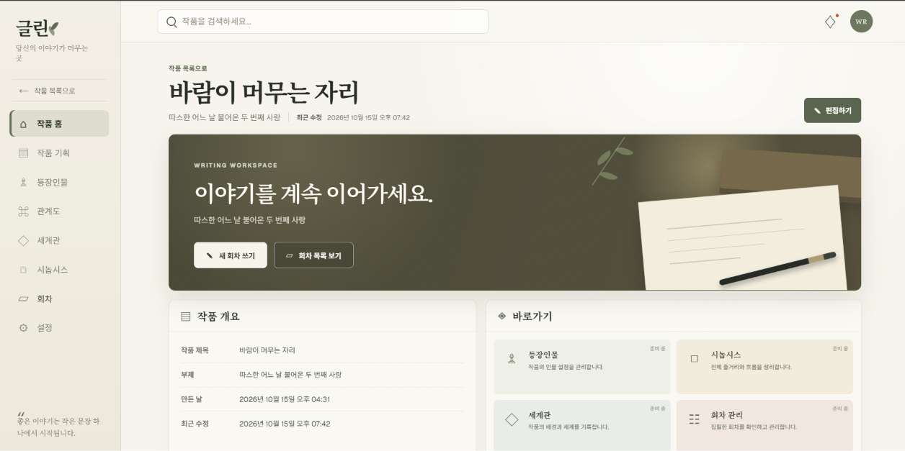
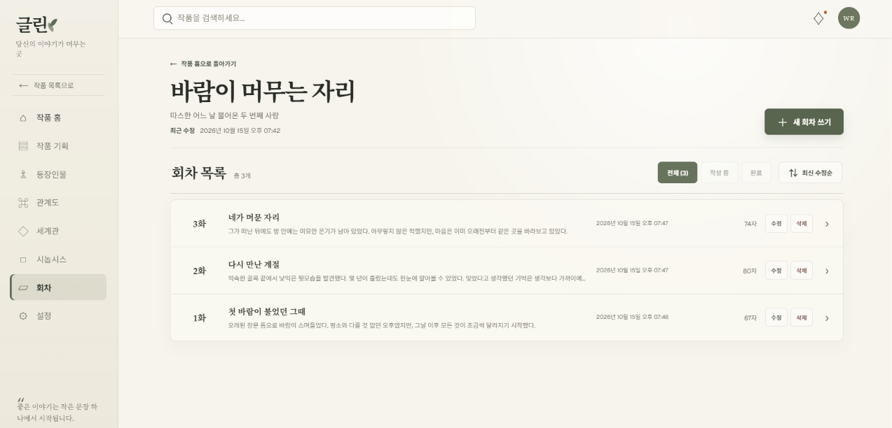
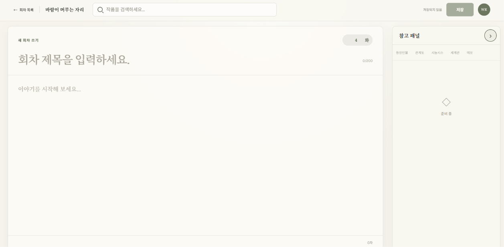
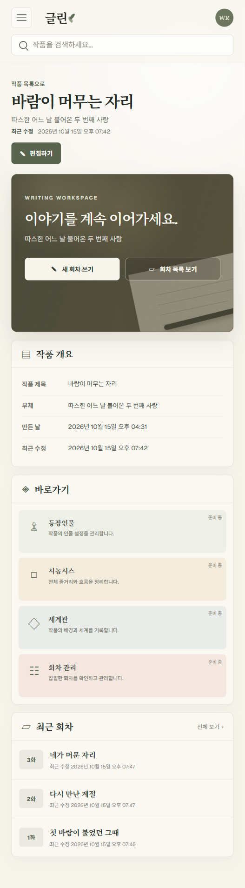
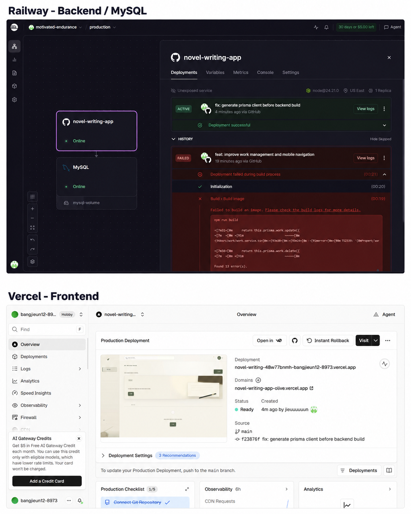

# 아크노트 (ArcNote)

> 웹소설 창작자를 위한 글쓰기·작품 관리 웹앱

웹소설을 즐겨 읽으며 창작 과정과 글쓰기 도구에 관심을 가지게 되었고,
기존에 사용해 본 글쓰기 서비스에서 느낀 장점과 불편함을 바탕으로 직접 기획하고 개발한 프로젝트입니다.

v1은 Google 계정으로 로그인한 뒤, 작품 기획부터 회차 집필까지 한 공간에서 이어 갈 수 있는 창작 워크스페이스입니다.

---

## Preview



---

## Demo

🌐 **[아크노트](https://novel-writing-app-olive.vercel.app)**

Frontend는 Vercel, Backend와 MySQL은 Railway에 구성했습니다.
Railway 인스턴스가 일시 중지되어 있으면 로그인이 되지 않을 수 있습니다.

---

## 주요 기능

### 작품 관리

- 작품 생성, 조회, 제목·부제 수정, 삭제
- 작품 검색
- 최근 작업 작품 표시
- 작품별 워크스페이스
- 작품 삭제 시 연결된 데이터 Cascade 삭제



### 작품 기획·설정

- 작품 기획 (장르, 로그라인, 소개 등)
- 등장인물 관리
- 등장인물 프로필 및 사용자 정의 항목
- 등장인물 관계 관리 (인물 쌍, 관계 설명)
- 세계관 설정 (작품당 하나)

### 시놉시스

- 시놉시스 버전 관리
- 새 버전 작성, 복제, 현재 버전 지정, 삭제

### 회차 집필

- 작품별 회차 목록
- 회차 작성·상세·수정·삭제
- 회차 순서(`sortOrder`) 지정과 중복 번호 검증
- 글자 수·저장 상태 표시
- 회차 에디터 Reference Panel
  - 등장인물
  - 관계도
  - 세계관
  - 현재 시놉시스





### 계정·정책

- Google OAuth 로그인
- 로그인 사용자 기준 데이터 분리
- 설정, 로그아웃, 계정 삭제
- 개인정보처리방침, 이용약관, 계정 삭제 안내

### UX

- PC / Mobile 반응형 UI
- 모바일 Sidebar → Drawer 전환
- Empty / Loading / Error, 잘못된 ID 접근 안내

<p align="center">
  
</p>

v1에는 통계, 자료실, AI 생성, 자동 저장, 리치 텍스트 에디터, 알림, 회차 상태 필터, 관계도 그래프 시각화는 포함하지 않습니다.

---

## 기술 스택

| 영역 | 기술 |
|---|---|
| Frontend | Next.js 16, React 19, TypeScript, App Router, CSS Modules |
| Backend | NestJS, REST API |
| ORM | Prisma 7 |
| Database | MySQL |
| 인증 | Google OAuth, JWT, httpOnly cookie |
| Deployment | Vercel (Frontend), Railway (Backend, MySQL) |
| Version Control | Git, GitHub |

Swagger는 개발 환경에서만 켜 두었습니다. Production에서는 비활성화합니다.

---

## 프로젝트 구조

```text
novel-writing-app/
├── frontend/          Next.js (Vercel)
├── backend/           NestJS + Prisma (Railway)
│   └── prisma/        스키마, 마이그레이션
└── docs/images/       README 스크린샷
```

화면 구조는 작품·회차 계층이 URL에 드러나도록 구성했습니다.

```text
/
/works
/works/[workId]
/works/[workId]/planning
/works/[workId]/characters
/works/[workId]/relations
/works/[workId]/world
/works/[workId]/synopsis
/works/[workId]/episodes
/works/[workId]/episodes/new
/works/[workId]/episodes/[episodeId]
/works/[workId]/episodes/[episodeId]/edit
/settings
/privacy
/terms
/account-deletion
```

Frontend는 `/api/auth`, `/api/work`, `/api/episode`를 NestJS로 rewrite합니다.
OAuth 콜백은 Frontend origin(`/api/auth/google/callback`)을 사용해 JWT 쿠키가 브라우저의 Frontend 도메인에 저장됩니다.

### 데이터 모델 (요약)

```text
USER
 └── WORK
      ├── EPISODE (N)
      ├── PLANNING (1)
      ├── CHARACTER (N)
      │    ├── PROFILE (1)
      │    └── CUSTOM FIELD (N)
      ├── CHARACTER RELATION (N)
      ├── WORLD SETTING (1)
      └── SYNOPSIS VERSION (N)
           └── Work.currentSynopsisVersionId
```

작품 삭제 시 하위 데이터는 Prisma `onDelete: Cascade`로 함께 삭제됩니다.

---

## 실행 방법

Backend 실행 전 MySQL을 켜고, 각 폴더의 `.env.example`을 참고해 `.env`를 준비합니다. 실제 비밀값은 저장소에 넣지 않습니다.

### Backend

```bash
cd backend
npm install
npx prisma generate
npm run start:dev
```

기본 포트는 `3001`입니다.

### Frontend

```bash
cd frontend
npm install
npm run dev
```

기본 포트는 `3000`입니다.

---

## 환경변수

세부 키와 설명은 `.env.example`을 기준으로 합니다.

### Frontend (`frontend/.env.example`)

| 변수 | 역할 |
|---|---|
| `BACKEND_URL` | NestJS 서버 주소. Next.js rewrite가 이 값을 사용합니다. |
| `NEXT_PUBLIC_DEFAULT_LOCALE` | UI 기본 언어. `ko` 또는 `en` |

로컬 예: `BACKEND_URL=http://localhost:3001`, `NEXT_PUBLIC_DEFAULT_LOCALE=ko`

### Backend (`backend/.env.example`)

| 변수 | 역할 |
|---|---|
| `DATABASE_HOST`, `DATABASE_PORT`, `DATABASE_USER`, `DATABASE_PASSWORD`, `DATABASE_NAME` | NestJS가 사용하는 DB 접속 정보 |
| `DATABASE_URL` | Prisma CLI용 연결 URL. 위 DB와 같은 대상을 가리켜야 합니다. |
| `PORT` | NestJS 포트 (로컬 기본 `3001`) |
| `GOOGLE_CLIENT_ID`, `GOOGLE_CLIENT_SECRET` | Google OAuth |
| `GOOGLE_CALLBACK_URL` | 브라우저가 실제로 방문하는 콜백 URL. 로컬은 `http://localhost:3000/api/auth/google/callback` |
| `JWT_SECRET`, `JWT_EXPIRES_IN` | JWT 서명·만료 |
| `FRONTEND_URL` | Frontend origin (로컬 `http://localhost:3000`) |

`.env`와 Secret 값은 Git에 포함하지 않습니다.

---

## 배포 구조

```text
User
 │
 ▼
Vercel
Next.js
 │  /api/* rewrite
 ▼
Railway
NestJS REST API
 │
 ▼
Prisma
 │
 ▼
Railway MySQL
```

<p align="center">
  
</p>

- Frontend Root Directory: `/frontend` (Vercel)
- Backend Root Directory: `/backend` (Railway)
- Database: Railway MySQL
- Production 마이그레이션: `npx prisma migrate deploy`

Railway 최초 배포에서 Prisma Client가 빌드 환경에 없어 `Cannot find module '.../generated/prisma/client.js'`가 났습니다. Backend build script에 Client 생성을 넣어 해결했습니다.

```json
"build": "prisma generate && nest build"
```

---

## AI-assisted Development

아크노트는 ChatGPT와 Cursor를 개발 보조 도구로 활용해 제작했습니다.

기능 기획, 요구사항 정의, 구조 결정, 구현 검토, 브라우저 테스트는 직접 진행했습니다.
AI는 코드 초안, 리팩터링 제안, 테스트 케이스 작성, 문제 분석을 보조했습니다.

AI가 생성한 결과를 그대로 쓰지 않았습니다. 실제 동작 확인과 수정 과정을 거친 뒤에 반영했습니다.

---

## 향후 계획 (v1.1)

v1.1에서는 아래를 짧게 다듬을 예정입니다.

- 회차 저장 경험 (상태 표시, 작성 흐름)
- Android / Google Play 패키징에 필요한 아이콘·스토어 자산
- 관계 정보의 읽기 경험

통계, 자료실, AI 생성, 자동 저장은 v1.1 범위에 넣지 않았습니다.
